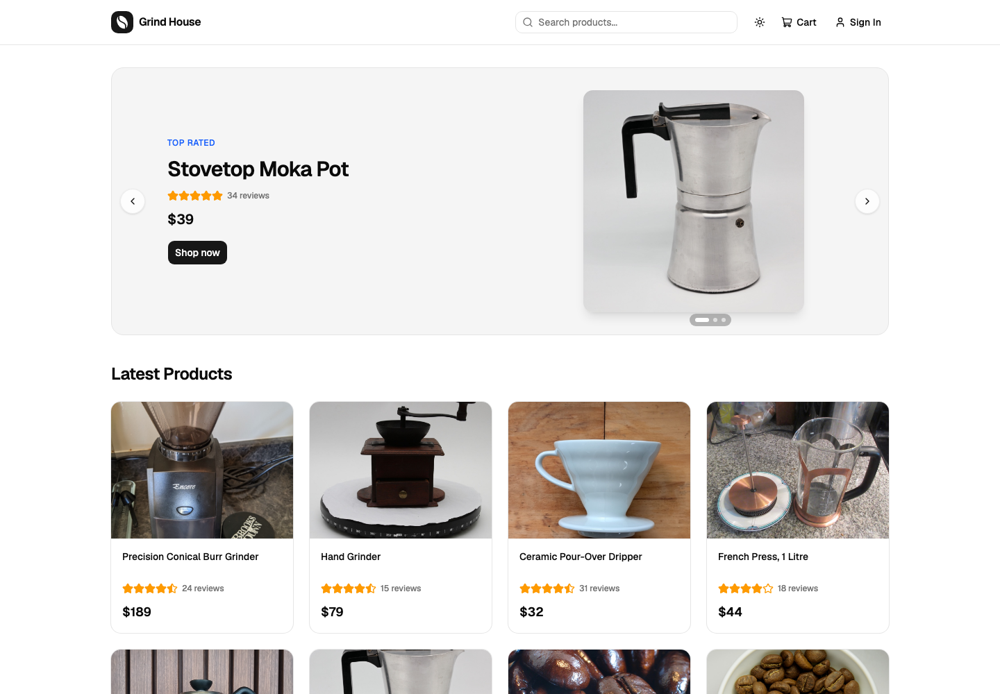
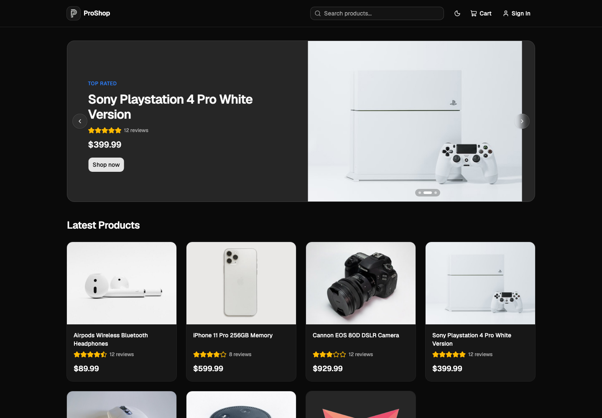
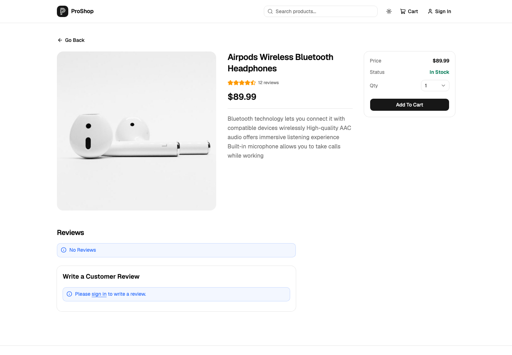

# Grind House

A full-stack eCommerce store for coffee gear and freshly roasted beans, built with the MERN stack and TypeScript. Customers can browse, search and review products, check out with PayPal, and track their orders. Admins manage products, users and orders.

**Live demo: [proshop-50w8.onrender.com](https://proshop-50w8.onrender.com)**

> Hosted on Render's free tier. If nobody has visited for a while, the first page load can take up to a minute while the server wakes up.



| Dark mode                                    | Product page                                  |
| -------------------------------------------- | --------------------------------------------- |
|  |  |

## Try it

Log in with a demo customer account:

| Email            | Password |
| ---------------- | -------- |
| `john@email.com` | `123456` |
| `jane@email.com` | `123456` |

Payments run in PayPal's **sandbox**, so no real money is involved. At checkout, pay with this sandbox buyer account:

| Email                                   | Password   |
| --------------------------------------- | ---------- |
| `sb-akiq626148978@personal.example.com` | `Gg20AeL.` |

The admin account isn't public, since it can edit and delete everything in the shop.

## Features

- Product catalogue with search, pagination and a top-rated carousel
- Product reviews and ratings
- Cart, shipping, and checkout with PayPal
- Order history on the customer's profile
- Admin: create and edit products with image uploads, manage users, mark orders as delivered
- Light, dark and system themes
- Responsive layout for phones and desktops

### Security

- Prices are calculated on the server from the database, so the client can't change what an order costs
- PayPal payments are verified with PayPal's API before an order is marked paid: the amount must match, and a payment can't be reused for another order
- Customers can only see and pay for their own orders
- JWT stored in an HTTP-only cookie
- Helmet security headers, rate limiting on login and registration, and input validation
- The server refuses to start in production without a strong `JWT_SECRET` and every required setting

## Tech stack

| Area     | Tools                                                                 |
| -------- | --------------------------------------------------------------------- |
| Frontend | React 19, TypeScript, Vite, React Router 8, Redux Toolkit (RTK Query) |
| UI       | Tailwind CSS v4, shadcn/ui, Lucide icons                              |
| Backend  | Node 22, Express 5, TypeScript, Mongoose 9                            |
| Data     | MongoDB Atlas, Cloudinary for product images                          |
| Payments | PayPal (sandbox)                                                      |
| Quality  | Vitest, Supertest, React Testing Library, Biome, GitHub Actions CI    |
| Hosting  | Render                                                                |

## Running it locally

You'll need Node 22.22 or newer, and either a local MongoDB or a free [MongoDB Atlas](https://www.mongodb.com/atlas) database.

1. Clone the repo and install the dependencies:

   ```bash
   git clone https://github.com/grmbyrn/grindhouse.git
   cd grindhouse
   npm install
   npm install --prefix frontend
   ```

2. Copy `.env.example` to `.env` and fill it in. You'll need:
   - `MONGO_URI`: your MongoDB connection string
   - `JWT_SECRET`: at least 32 random characters (the file shows a command that generates one)
   - `PAYPAL_CLIENT_ID` and `PAYPAL_APP_SECRET`: from a sandbox app in the [PayPal developer dashboard](https://developer.paypal.com)
   - `SEED_ADMIN_PASSWORD`: the password for `admin@email.com`
   - The `CLOUDINARY_*` values are optional locally. Without them, uploaded images are saved to `./uploads`.

3. Load the sample products and users. This deletes everything already in the database:

   ```bash
   npm run data:import
   ```

4. Start the backend and frontend together:

   ```bash
   npm run dev
   ```

   The shop opens at [localhost:3000](http://localhost:3000), and the API runs on port 5000.

### Scripts

| Command                | What it does                                        |
| ---------------------- | --------------------------------------------------- |
| `npm run dev`          | Runs the backend and frontend with live reload      |
| `npm test`             | Runs the backend and frontend tests                 |
| `npm run typecheck`    | Type-checks the backend, tests and frontend         |
| `npm run check`        | Lints and checks formatting with Biome              |
| `npm run format`       | Formats the code with Biome                         |
| `npm run build`        | Builds the backend and frontend for production      |
| `npm start`            | Runs the production build                           |
| `npm run data:import`  | Replaces the database contents with the sample data |
| `npm run data:destroy` | Deletes all users, products and orders              |

Every pull request runs the lint, type checks, tests and a production build on GitHub Actions.

## Deploying

The live site runs as a single Render Web Service: Express serves both the API and the built React app.

- **Build command:** `npm run build`
- **Start command:** `npm start`
- **Health check path:** `/api/health`
- **Environment variables:** `NODE_ENV=production`, `MONGO_URI`, `JWT_SECRET`, `PAYPAL_CLIENT_ID`, `PAYPAL_APP_SECRET`, `PAGINATION_LIMIT`, `CLOUDINARY_CLOUD_NAME`, `CLOUDINARY_API_KEY` and `CLOUDINARY_API_SECRET`

Cloudinary is required in production because Render's disk is wiped on every deploy.

## Changelog

**2023:** Built as a JavaScript MERN app with Create React App, React Bootstrap and Express 4.

**2026: modernization.** Each step was tested and merged before the next one started.

1. Upgraded the backend to Express 5, Mongoose 9 and Multer 2.
2. Moved the frontend from Create React App to Vite.
3. Upgraded to React 19, Redux Toolkit 2 and the latest React Router.
4. Converted the frontend and backend to TypeScript.
5. Fixed security issues: server-side prices, PayPal payment verification, order ownership checks, admin-only uploads, security headers, rate limits and input validation.
6. Replaced Bootstrap with Tailwind CSS and shadcn/ui, redesigned the pages, and added dark mode.
7. Prepared for production: startup checks for required settings, a health check route, and image uploads to Cloudinary.
8. Added backend and frontend tests, Biome, GitHub Actions CI, code splitting for the admin pages, and React Router 8.
9. Deployed to Render with MongoDB Atlas.
10. Rebranded from ProShop to Grind House, with a new coffee catalogue, logo and favicon.

## Credits

Product photos are from Wikimedia Commons, used under Creative Commons licences. The authors and licences are listed in [docs/photo-credits.md](docs/photo-credits.md). The brands in the catalogue are made up.

## License

[MIT](LICENSE)
